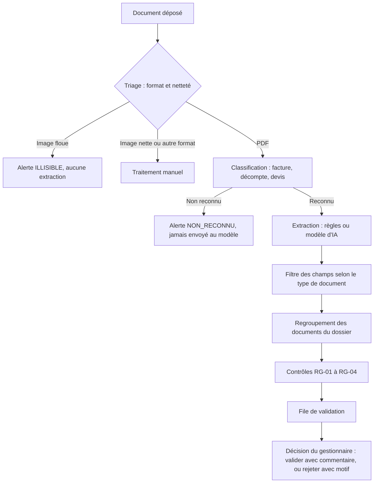

# Instruction assistée des remboursements santé (IA)

Prototype d'aide à l'instruction des demandes de remboursement d'une complémentaire santé.
Le système lit un document (facture, décompte, devis), en extrait les informations, applique des
contrôles de cohérence et prépare un dossier pour un gestionnaire, **qui garde toujours la décision**.

Projet personnel de formation, mené en **chef de projet MOA** et en Agile Scrum (3 sprints).
**Toutes les données sont fictives.** Aucune donnée réelle de santé n'est utilisée ni ne doit être ajoutée.

> Développé avec l'aide d'un assistant d'IA générative (Claude, d'Anthropic) pour le code ;
> le cadrage, les règles de gestion, les décisions et la validation sont ceux de l'auteur.

## Ce que fait le prototype



**Règles de gestion**

| Règle | Contrôle |
|---|---|
| RG-01 | Le remboursement total (assurance maladie + mutuelle) ne dépasse ni le plafond du contrat, ni la dépense réelle |
| RG-02 | Un dossier identique à un dossier déjà déposé est signalé comme doublon |
| RG-03 | La date des soins ne peut pas être postérieure à la date de dépôt |
| RG-04 | Le bénéficiaire doit figurer au contrat |
| RG-05 | Un devis ou un document non reconnu n'entre pas dans le calcul de remboursement |

## Principes de conception

- **Jamais deviné.** Un champ introuvable reste « manquant », un calcul impossible reste vide, une image illisible ne produit aucune extraction. Une valeur inventée est plus dangereuse qu'une valeur absente.
- **Le modèle propose, le code vérifie.** Les réponses d'un modèle d'IA passent par des contrôles déterministes : dates réelles, montants valides, somme des lignes égale au total, champs cohérents avec le type du document.
- **Une alerte est un signal, pas un verdict.** Aucune décision n'est automatique : le gestionnaire valide (commentaire obligatoire en cas d'alerte) ou rejette (motif obligatoire), et la décision est tracée.
- **Un extracteur interchangeable.** Règles locales ou modèle d'IA sur AWS Bedrock, choisis par configuration, derrière la même interface.
- **Calculs en centimes entiers**, pas en virgule flottante.

## Résultats de la comparaison des extracteurs

Mesurés sur 10 dossiers fictifs (détail dans [`docs/evaluation`](docs/evaluation)).

| Extracteur | Valeurs lues juste (sur 32) | Valeurs inventées | Anomalies détectées |
|---|---|---|---|
| Règles | 29 | 0 | 5 sur 5 |
| Nova Lite (Amazon) | 32, puis 31 à la seconde exécution | 0 | 5 sur 5 |
| Claude Haiku 4.5 (Anthropic) | 31 | 0 | 5 sur 5 |

**À lire avec prudence :** le jeu est minuscule, fictif et à la mise en page régulière ; les écarts entre les deux modèles ne sont pas significatifs ; un modèle peut répondre différemment d'une exécution à l'autre, même à température 0. Les limites complètes sont dans [`docs/evaluation/conclusions.md`](docs/evaluation/conclusions.md).

## Lancer le projet

Prérequis : Node.js 22 ou plus récent (testé avec Node 22).

```bash
npm install
npm test                                              # tests automatisés
npm run extract -- samples/TC-03_decompte_RO.pdf      # un document, extracteur à règles
npx ts-node src/fileCli.ts                            # la file de validation sur le jeu de test
npx ts-node src/evaluation/cli.ts --nom "Regles"      # mesure de qualité
npx ts-node src/evaluation/comparer.ts                # rapport comparatif
```

**Utiliser un modèle d'IA (AWS Bedrock)** : variables d'environnement de la session uniquement.

| Variable | Rôle |
|---|---|
| `EXTRACTEUR` | `regles` (défaut) ou `bedrock` |
| `BEDROCK_MODEL_ID` | identifiant du modèle ou du profil d'inférence |
| `AWS_REGION` | région (défaut `eu-north-1`) |
| `BEDROCK_TEMPERATURE` | nombre, ou `none` pour ne pas l'envoyer |
| `AWS_BEARER_TOKEN_BEDROCK` | clé d'API Bedrock **à courte durée** |

> **Sécurité :** ne jamais écrire de clé AWS dans un fichier ni dans ce dépôt. Utiliser une clé à courte durée, placée dans la session du terminal.

## Structure du dépôt

| Dossier | Contenu |
|---|---|
| `src/extraction` | Extracteurs (règles, Bedrock), classification, validation des réponses du modèle |
| `src/quality` | Mesure de netteté des images |
| `src/controls` | Contrôles métier RG-01 à RG-04 |
| `src/validation` | Dossier, alertes, file de validation du gestionnaire |
| `src/evaluation` | Mesure de qualité et comparaison |
| `tests` | Tests automatisés |
| `samples` | Documents fictifs, contrat fictif et résultats attendus |
| `docs` | Documentation du projet |

## Documentation

**Cadrage MOA :** [charte](docs/charte-projet.md) · [glossaire et règles de gestion](docs/glossaire.md) · [circuit de remboursement](docs/circuit-remboursement.md) · [cas de test](docs/cas-de-test.md) · [backlog](docs/backlog.md)

**Décisions d'architecture :**
[ADR-001 interface d'extraction](docs/adr/ADR-001-interface-extraction.md) ·
[ADR-002 netteté des images](docs/adr/ADR-002-nettete-image.md) ·
[ADR-003 spike Bedrock](docs/adr/ADR-003-bedrock.md) ·
[ADR-004 extracteur Bedrock](docs/adr/ADR-004-extracteur-bedrock.md)

**Pilotage :** [rétrospective sprint 1](docs/retrospectives/sprint-1.md) · [rétrospective sprint 2](docs/retrospectives/sprint-2.md) · [rétrospective sprint 3](docs/retrospectives/sprint-3.md)

**Évaluation :** [comparaison](docs/evaluation/comparaison.md) · [conclusions](docs/evaluation/conclusions.md)

Le suivi détaillé des sprints (backlog, tableau, burndown) est tenu dans Jira, accès sur demande.

**Déploiement AWS :** [démonstration Lambda et S3](docs/deploiement.md)

## Limites connues

- Données fictives et jeu de test minuscule : les résultats ne se généralisent pas à de vrais documents.
- Pas d'OCR : les images, même nettes, sont renvoyées au traitement manuel. Les PDF scannés sans texte ne sont pas pris en charge.
- Seul le format PNG est évalué pour la netteté.
- Le modèle de remboursement est simplifié (pas de participation forfaitaire, ni de franchise).
- Le registre des doublons est en mémoire ; l'affichage de la file se fait en console.
- Un titre de document inhabituel (« note d'honoraires ») n'est pas reconnu par la classification.

## Suite possible

Indicateurs de pilotage, lecture des images par le modèle, jeu de test à la mise en page variée avec mesures répétées, persistance des dossiers, interface web pour le gestionnaire.

## Licence

MIT
