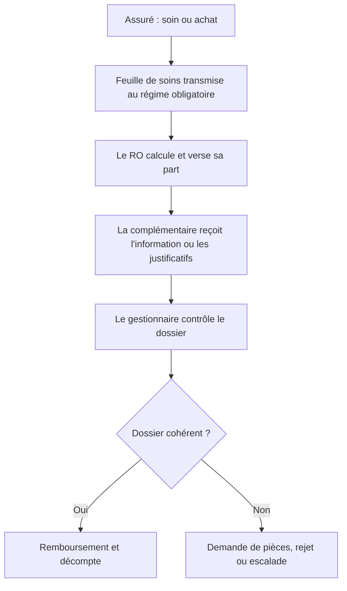

# Circuit de remboursement (as-is simplifié)

## Où le projet intervient
L'étape **E** : lecture des documents, extraction des informations et contrôles
de cohérence, avec décision finale du gestionnaire.

## Points de friction supposés (à valider avec un professionnel)
- Saisie manuelle des informations de chaque document
- Relecture des montants et des plafonds de garantie
- Détection des doublons
- Retours à l'assuré pour pièces manquantes
