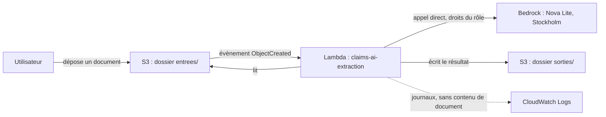

# Déploiement de la démonstration sur AWS (US-13)

Une démonstration minimale : un document déposé dans un bucket S3 est traité automatiquement par une
fonction AWS Lambda, qui écrit le résultat dans le même bucket. **Toutes les données sont fictives.**

## Architecture



L'extracteur se choisit par variable d'environnement de la fonction (`EXTRACTEUR=regles` ou `bedrock`),
sans changer le code : le déploiement a été validé d'abord avec les règles, puis avec Nova Lite.

## Décisions de sécurité

| Décision | Raison |
|---|---|
| Entrée (`entrees/`) et sortie (`sorties/`) dans des dossiers séparés, déclencheur limité à `entrees/`, et le code ignore tout le reste | Une fonction qui écrit là où elle est déclenchée tourne en boucle et coûte cher. Deux barrières : le filtre S3 et le code (testé) |
| Aucune clé AWS : la fonction utilise un **rôle** | Rien à protéger, rien à faire fuiter |
| Rôle aux droits minimaux : lire `entrees/*`, écrire `sorties/*`, appeler **uniquement** Nova Lite | Si la fonction était détournée, elle ne pourrait ni lire les sorties, ni supprimer, ni appeler un modèle plus cher |
| Bucket privé (les 4 protections d'accès public activées), chiffré, fichiers supprimés au bout d'un jour | Données de santé par nature (ici fictives) : on ne garde rien, on n'expose rien |
| Autorisation S3 vers Lambda limitée à ce bucket et à ce compte | Aucun autre bucket ne peut déclencher la fonction |
| Aucune relance automatique en cas d'erreur | Une relance répéterait l'appel payant au modèle |
| Erreur écrite dans un fichier **sans détail** ; le détail reste dans les journaux | Un message d'erreur AWS peut contenir des identifiants de compte |
| Taille limitée à 5 Mo, vérifiée avant lecture | Évite un fichier énorme, donc un coût imprévu |
| Contenu des documents jamais écrit dans les journaux | Minimisation des données |

## Mesures réelles (extracteur à règles, 512 Mo)

| | Démarrage à froid | Fonction déjà « chaude » |
|---|---|---|
| Durée du traitement | 1 007 ms | 300 ms |
| Démarrage (initialisation) | 450 ms | aucun |
| Durée facturée | 1 458 ms | 301 ms |
| Mémoire utilisée | 133 Mo | 135 Mo |

- Le démarrage à froid est **facturé** (traitement + initialisation).
- La fonction utilise environ 26 % de la mémoire allouée. Descendre à 256 Mo économiserait des fractions de
  millième de centime et pourrait rallonger la durée (la puissance de calcul dépend de la mémoire) : **non fait**.
- Avec Nova Lite : un appel de modèle par document, environ 540 tokens en entrée et 130 en sortie.
- **Le poste de coût à surveiller est Bedrock (les tokens), pas le calcul Lambda.**

## Déployer et démonter

Prérequis : un fichier `lambda.zip`, construit sous Linux par [`scripts/build-lambda.sh`](../scripts/build-lambda.sh)
(la bibliothèque PDF embarque un composant natif : un paquet construit sous Windows ne fonctionnerait pas).

```bash
# dans AWS CloudShell, après avoir envoyé lambda.zip
bash deploy.sh                       # extracteur à règles
EXTRACTEUR=bedrock bash deploy.sh    # extracteur Bedrock (Nova Lite)
bash teardown.sh                     # supprime tout, après confirmation
```

Scripts : [`deploy/deploy.sh`](../deploy/deploy.sh) et [`deploy/teardown.sh`](../deploy/teardown.sh).

**Arrêt d'urgence** (met la fonction à l'arrêt) :

```bash
aws lambda put-function-concurrency --function-name claims-ai-extraction --reserved-concurrent-executions 0 --region eu-north-1
```

## Limites connues

- Une démonstration, pas un service : pas d'interface, pas d'authentification utilisateur (l'accès se fait par le
  compte AWS), pas de file d'attente d'erreurs, pas d'alarme sur les erreurs de la fonction.
- Le déploiement est temporaire : le plan gratuit AWS se termine environ six mois après la création du compte.
- Le contrôle des dossiers (doublons, dates, plafond, bénéficiaire) n'est pas branché dans la fonction :
  elle traite un document à la fois et renvoie son extraction.
- La construction du paquet exige Linux (ou CloudShell).
- Les scripts reprennent des commandes exécutées une à une avec succès ; `deploy.sh` et `teardown.sh`,
  eux, n'ont pas été rejoués en entier au moment de la rédaction de ce document.

## Ce que cette story m'a appris (pilotage)

- **Un changement de périmètre se chiffre.** L'option « fonction Lambda » a été préférée à l'option « bucket et
  CloudShell » : plus convaincante, mais plus de composants, de droits à régler et de risques. L'estimation de la
  story est passée d'environ 3 à environ 5 points, et le changement est tracé dans Jira.
- **Isoler pour diagnostiquer.** Fonction invoquée à la main avant de brancher S3 ; extracteur à règles avant le
  modèle : un seul changement à la fois.
- **Optimiser ce qui coûte.** Mesurer d'abord (133 Mo utilisés sur 512) a montré que le calcul ne valait pas
  l'effort ; le coût réel est dans les appels au modèle.
- **Prévoir la sortie dès l'entrée.** Une procédure de démontage et un arrêt d'urgence font partie du livrable.
